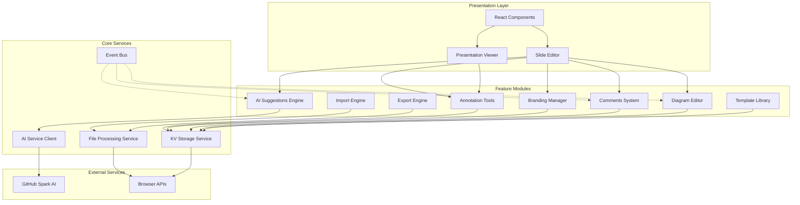
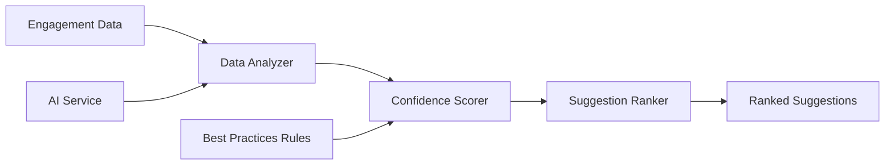
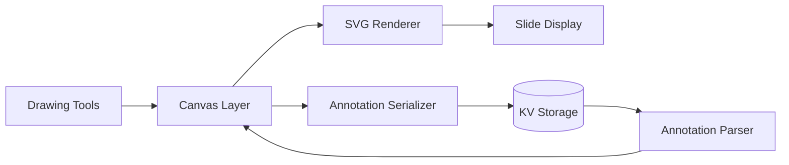
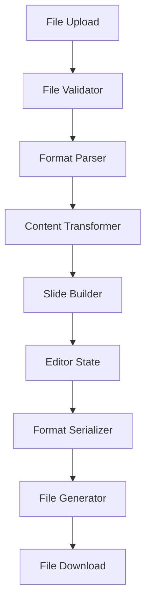
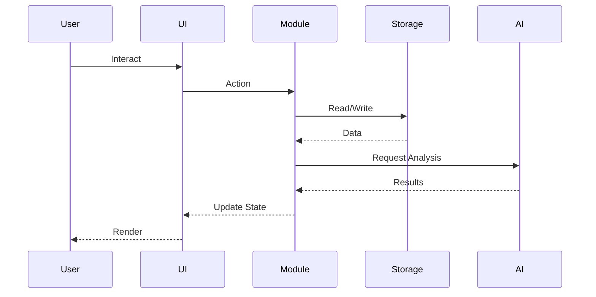

# Design Document: GammaX Completion Phase

## Overview

### Purpose

هذا المستند يحدد التصميم التقني الشامل لإكمال مشروع GammaX بإضافة ثمانية ميزات رئيسية تحقق التكافؤ الكامل مع Gamma AI. يغطي التصميم المعمارية، المكونات، نماذج البيانات، الواجهات البرمجية، وخصائص الصحة (Correctness Properties) لضمان جودة وموثوقية التطبيق.

### Scope

يشمل هذا التصميم:

1. **AI-Powered Slide Suggestions**: محرك ذكاء اصطناعي لتحليل بيانات التفاعل وتقديم اقتراحات تحسين
2. **Slide Annotation Tools**: أدوات رسم وتعليق متقدمة للعروض التقديمية
3. **Custom Branding Presets**: نظام إدارة الهوية البصرية للشركات
4. **Enhanced Slide Comments System**: نظام تعليقات متقدم مع دعم المحادثات المتسلسلة
5. **PowerPoint & PDF Import**: محرك استيراد من صيغ خارجية
6. **Export to PowerPoint**: محرك تصدير إلى PPTX
7. **Interactive Diagram Editor**: محرر مرئي تفاعلي للرسوم البيانية
8. **Diagram Templates Library**: مكتبة قوالب رسوم بيانية جاهزة

### Technology Stack

- **Frontend Framework**: React 19 + TypeScript
- **Build Tool**: Vite
- **Styling**: Tailwind CSS + Framer Motion
- **UI Components**: Shadcn UI
- **AI Integration**: GitHub Spark
- **Data Storage**: KV Storage
- **Visualization**: D3.js
- **File Processing**: 
  - PPTX: PptxGenJS (export), pizzip + xml2js (import)
  - PDF: pdf.js (import)
- **Property-Based Testing**: fast-check

## Architecture

### System Architecture



### Module Architecture

#### 1. AI Suggestions Engine



#### 2. Annotation System



#### 3. Import/Export Pipeline



### Data Flow Architecture



## Components and Interfaces

### 1. AI Suggestions Engine

#### Components

**AIAnalyzer**
```typescript
interface AIAnalyzer {
  analyzeEngagement(data: EngagementData): Promise<AnalysisResult>;
  generateSuggestions(analysis: AnalysisResult): Promise<Suggestion[]>;
  calculateConfidence(suggestion: Suggestion): number;
}
```

**SuggestionManager**
```typescript
interface SuggestionManager {
  fetchSuggestions(presentationId: string): Promise<Suggestion[]>;
  applySuggestion(suggestionId: string): Promise<void>;
  dismissSuggestion(suggestionId: string): Promise<void>;
  rankSuggestions(suggestions: Suggestion[]): Suggestion[];
}
```

**SuggestionsPanel Component**
```typescript
interface SuggestionsPanelProps {
  presentationId: string;
  onApply: (suggestion: Suggestion) => void;
  onDismiss: (suggestionId: string) => void;
}
```

#### Interfaces

```typescript
interface EngagementData {
  presentationId: string;
  views: number;
  averageViewTime: number;
  dropOffRates: Map<number, number>; // slideIndex -> dropOffRate
  comments: CommentData[];
  interactions: InteractionEvent[];
}

interface Suggestion {
  id: string;
  type: SuggestionType;
  targetSlideIndex: number;
  title: string;
  description: string;
  rationale: string;
  confidenceScore: number; // 0-100
  impactLevel: 'High' | 'Medium' | 'Low';
  action: SuggestionAction;
  createdAt: Date;
}

type SuggestionType = 
  | 'content-density'
  | 'visual-balance'
  | 'text-readability'
  | 'engagement-optimization'
  | 'layout-improvement';

interface SuggestionAction {
  type: 'modify-text' | 'adjust-layout' | 'add-visual' | 'simplify-content';
  parameters: Record<string, any>;
}

interface AnalysisResult {
  contentDensityScores: number[];
  visualBalanceScores: number[];
  readabilityScores: number[];
  engagementPatterns: EngagementPattern[];
}
```

### 2. Annotation Tools

#### Components

**AnnotationToolbar Component**
```typescript
interface AnnotationToolbarProps {
  selectedTool: AnnotationTool;
  onToolChange: (tool: AnnotationTool) => void;
  color: string;
  strokeWidth: number;
  onColorChange: (color: string) => void;
  onStrokeWidthChange: (width: number) => void;
}
```

**AnnotationCanvas Component**
```typescript
interface AnnotationCanvasProps {
  slideId: string;
  annotations: Annotation[];
  activeTool: AnnotationTool;
  onAnnotationCreate: (annotation: Annotation) => void;
  onAnnotationUpdate: (id: string, updates: Partial<Annotation>) => void;
  onAnnotationDelete: (id: string) => void;
}
```

**AnnotationManager**
```typescript
interface AnnotationManager {
  createAnnotation(slideId: string, annotation: Annotation): Promise<void>;
  updateAnnotation(id: string, updates: Partial<Annotation>): Promise<void>;
  deleteAnnotation(id: string): Promise<void>;
  getAnnotations(slideId: string): Promise<Annotation[]>;
  undo(): void;
  redo(): void;
}
```

#### Interfaces

```typescript
type AnnotationTool = 
  | 'arrow'
  | 'circle'
  | 'rectangle'
  | 'line'
  | 'freehand'
  | 'text'
  | 'highlight'
  | 'eraser';

interface Annotation {
  id: string;
  slideId: string;
  type: AnnotationTool;
  geometry: AnnotationGeometry;
  style: AnnotationStyle;
  layer: number;
  createdAt: Date;
  updatedAt: Date;
}

interface AnnotationGeometry {
  points: Point[];
  bounds?: BoundingBox;
  text?: string;
}

interface Point {
  x: number;
  y: number;
}

interface BoundingBox {
  x: number;
  y: number;
  width: number;
  height: number;
}

interface AnnotationStyle {
  color: string;
  strokeWidth: number;
  fillColor?: string;
  opacity?: number;
  fontSize?: number;
  fontFamily?: string;
}

interface AnnotationHistory {
  past: AnnotationState[];
  present: AnnotationState;
  future: AnnotationState[];
}

interface AnnotationState {
  annotations: Map<string, Annotation>;
  timestamp: Date;
}
```

### 3. Branding Manager

#### Components

**BrandingPresetsPanel Component**
```typescript
interface BrandingPresetsPanelProps {
  presets: BrandingPreset[];
  onSelect: (preset: BrandingPreset) => void;
  onCreate: () => void;
  onEdit: (presetId: string) => void;
  onDelete: (presetId: string) => void;
}
```

**BrandingPresetEditor Component**
```typescript
interface BrandingPresetEditorProps {
  preset?: BrandingPreset;
  onSave: (preset: BrandingPreset) => void;
  onCancel: () => void;
}
```

**BrandingManager**
```typescript
interface BrandingManager {
  createPreset(preset: BrandingPreset): Promise<void>;
  updatePreset(id: string, updates: Partial<BrandingPreset>): Promise<void>;
  deletePreset(id: string): Promise<void>;
  getPresets(): Promise<BrandingPreset[]>;
  applyPreset(presentationId: string, presetId: string): Promise<void>;
  previewPreset(preset: BrandingPreset): PreviewData;
}
```

#### Interfaces

```typescript
interface BrandingPreset {
  id: string;
  name: string;
  logo?: LogoData;
  colors: BrandingColors;
  fonts: BrandingFonts;
  createdAt: Date;
  updatedAt: Date;
}

interface LogoData {
  url: string;
  width: number;
  height: number;
  position: 'top-left' | 'top-right' | 'bottom-left' | 'bottom-right';
  size: number; // percentage
}

interface BrandingColors {
  primary: string;
  secondary: string;
  accent: string;
  background?: string;
  text?: string;
}

interface BrandingFonts {
  heading: FontConfig;
  body: FontConfig;
}

interface FontConfig {
  family: string;
  weight?: number;
  size?: number;
}

interface PreviewData {
  sampleSlide: SlidePreview;
  colorPalette: string[];
  fontSamples: FontSample[];
}
```

### 4. Comments System

#### Components

**CommentsPanel Component**
```typescript
interface CommentsPanelProps {
  presentationId: string;
  currentSlideIndex: number;
  filter: CommentFilter;
  onFilterChange: (filter: CommentFilter) => void;
}
```

**CommentThread Component**
```typescript
interface CommentThreadProps {
  thread: CommentThread;
  onReply: (parentId: string, content: string) => void;
  onResolve: (commentId: string) => void;
  onEdit: (commentId: string, content: string) => void;
  onDelete: (commentId: string) => void;
}
```

**CommentsManager**
```typescript
interface CommentsManager {
  createComment(comment: Comment): Promise<void>;
  replyToComment(parentId: string, reply: Comment): Promise<void>;
  updateComment(id: string, content: string): Promise<void>;
  deleteComment(id: string): Promise<void>;
  resolveComment(id: string): Promise<void>;
  getComments(presentationId: string, filter?: CommentFilter): Promise<CommentThread[]>;
  subscribeToUpdates(callback: (update: CommentUpdate) => void): () => void;
}
```

#### Interfaces

```typescript
interface Comment {
  id: string;
  presentationId: string;
  slideIndex: number;
  parentId?: string;
  content: string;
  author: Author;
  resolved: boolean;
  createdAt: Date;
  updatedAt?: Date;
  deletedAt?: Date;
}

interface Author {
  id: string;
  name: string;
  avatar?: string;
}

interface CommentThread {
  rootComment: Comment;
  replies: CommentThread[];
  totalReplies: number;
  unresolvedCount: number;
}

type CommentFilter = 'all' | 'resolved' | 'unresolved';

interface CommentUpdate {
  type: 'created' | 'updated' | 'deleted' | 'resolved';
  comment: Comment;
  timestamp: Date;
}

interface CommentStats {
  totalComments: number;
  unresolvedComments: number;
  commentsBySlide: Map<number, number>;
}
```

### 5. Import Engine

#### Components

**FileUploader Component**
```typescript
interface FileUploaderProps {
  acceptedFormats: string[];
  maxSize: number;
  onUpload: (file: File) => void;
  onError: (error: ImportError) => void;
}
```

**ImportProgress Component**
```typescript
interface ImportProgressProps {
  progress: number;
  status: string;
  onCancel?: () => void;
}
```

**ImportEngine**
```typescript
interface ImportEngine {
  importFile(file: File): Promise<Presentation>;
  validateFile(file: File): ValidationResult;
  parseFile(file: File): Promise<ParsedContent>;
  transformContent(parsed: ParsedContent): Promise<Presentation>;
}
```

#### Interfaces

```typescript
interface ImportOptions {
  preserveFormatting: boolean;
  aiEnhancement: boolean;
  maxFileSize: number;
}

interface ValidationResult {
  valid: boolean;
  errors: string[];
  warnings: string[];
}

interface ParsedContent {
  format: 'pptx' | 'ppt' | 'pdf';
  slides: ParsedSlide[];
  metadata: FileMetadata;
}

interface ParsedSlide {
  index: number;
  layout: string;
  elements: ParsedElement[];
  notes?: string;
}

interface ParsedElement {
  type: 'text' | 'image' | 'shape' | 'table' | 'chart';
  content: any;
  position: Position;
  style: ElementStyle;
}

interface Position {
  x: number;
  y: number;
  width: number;
  height: number;
}

interface ElementStyle {
  fontSize?: number;
  fontFamily?: string;
  color?: string;
  backgroundColor?: string;
  borderColor?: string;
  borderWidth?: number;
}

interface FileMetadata {
  title?: string;
  author?: string;
  createdDate?: Date;
  modifiedDate?: Date;
  slideCount: number;
}

interface ImportError {
  code: string;
  message: string;
  details?: any;
}
```

### 6. Export Engine

#### Components

**ExportDialog Component**
```typescript
interface ExportDialogProps {
  presentationId: string;
  formats: ExportFormat[];
  onExport: (format: ExportFormat, options: ExportOptions) => void;
}
```

**ExportEngine**
```typescript
interface ExportEngine {
  exportToPPTX(presentation: Presentation, options: ExportOptions): Promise<Blob>;
  validateExport(presentation: Presentation): ValidationResult;
  transformToFormat(presentation: Presentation, format: ExportFormat): Promise<any>;
  generateFile(data: any, format: ExportFormat): Promise<Blob>;
}
```

#### Interfaces

```typescript
type ExportFormat = 'pptx' | 'pdf' | 'html';

interface ExportOptions {
  includeAnnotations: boolean;
  includeComments: boolean;
  quality: 'high' | 'medium' | 'low';
  compatibility: 'modern' | 'legacy';
}

interface ExportResult {
  blob: Blob;
  filename: string;
  size: number;
  format: ExportFormat;
}

interface PPTXSlideData {
  layout: string;
  elements: PPTXElement[];
  background?: BackgroundData;
  transition?: TransitionData;
}

interface PPTXElement {
  type: string;
  x: number;
  y: number;
  w: number;
  h: number;
  options: Record<string, any>;
}

interface BackgroundData {
  color?: string;
  image?: string;
}

interface TransitionData {
  type: string;
  duration: number;
}
```

### 7. Diagram Editor

#### Components

**DiagramCanvas Component**
```typescript
interface DiagramCanvasProps {
  diagram: Diagram;
  selectedNodes: string[];
  selectedConnections: string[];
  onNodeAdd: (node: DiagramNode) => void;
  onNodeUpdate: (id: string, updates: Partial<DiagramNode>) => void;
  onNodeDelete: (id: string) => void;
  onConnectionAdd: (connection: DiagramConnection) => void;
  onConnectionUpdate: (id: string, updates: Partial<DiagramConnection>) => void;
  onConnectionDelete: (id: string) => void;
  onSelectionChange: (nodeIds: string[], connectionIds: string[]) => void;
}
```

**DiagramToolbar Component**
```typescript
interface DiagramToolbarProps {
  selectedShape: NodeShape;
  onShapeChange: (shape: NodeShape) => void;
  onUndo: () => void;
  onRedo: () => void;
  canUndo: boolean;
  canRedo: boolean;
}
```

**DiagramEditor**
```typescript
interface DiagramEditor {
  createNode(node: DiagramNode): void;
  updateNode(id: string, updates: Partial<DiagramNode>): void;
  deleteNode(id: string): void;
  createConnection(connection: DiagramConnection): void;
  updateConnection(id: string, updates: Partial<DiagramConnection>): void;
  deleteConnection(id: string): void;
  groupNodes(nodeIds: string[]): string;
  ungroupNodes(groupId: string): void;
  alignNodes(nodeIds: string[], alignment: Alignment): void;
  undo(): void;
  redo(): void;
  autoSave(): Promise<void>;
}
```

#### Interfaces

```typescript
interface Diagram {
  id: string;
  slideId: string;
  nodes: Map<string, DiagramNode>;
  connections: Map<string, DiagramConnection>;
  groups: Map<string, NodeGroup>;
  bounds: BoundingBox;
  createdAt: Date;
  updatedAt: Date;
}

interface DiagramNode {
  id: string;
  shape: NodeShape;
  position: Point;
  size: Size;
  text: string;
  style: NodeStyle;
  groupId?: string;
}

type NodeShape = 
  | 'rectangle'
  | 'circle'
  | 'diamond'
  | 'hexagon'
  | 'rounded-rectangle'
  | 'triangle'
  | 'parallelogram'
  | 'cylinder';

interface Size {
  width: number;
  height: number;
}

interface NodeStyle {
  fillColor: string;
  borderColor: string;
  borderWidth: number;
  textColor: string;
  fontSize: number;
  fontFamily: string;
}

interface DiagramConnection {
  id: string;
  sourceNodeId: string;
  targetNodeId: string;
  sourceAnchor: AnchorPoint;
  targetAnchor: AnchorPoint;
  style: ConnectionStyle;
  label?: string;
  labelPosition?: number; // 0-1, position along the line
}

type AnchorPoint = 'top' | 'right' | 'bottom' | 'left' | 'center';

interface ConnectionStyle {
  lineStyle: 'solid' | 'dashed' | 'dotted';
  lineColor: string;
  lineWidth: number;
  arrowStyle: 'none' | 'single' | 'double';
}

interface NodeGroup {
  id: string;
  nodeIds: string[];
  bounds: BoundingBox;
}

type Alignment = 'left' | 'center' | 'right' | 'top' | 'middle' | 'bottom';

interface DiagramHistory {
  past: DiagramState[];
  present: DiagramState;
  future: DiagramState[];
}

interface DiagramState {
  diagram: Diagram;
  timestamp: Date;
}
```

### 8. Template Library

#### Components

**TemplateLibrary Component**
```typescript
interface TemplateLibraryProps {
  onTemplateSelect: (template: DiagramTemplate) => void;
  onTemplateApply: (templateId: string) => void;
}
```

**TemplateGrid Component**
```typescript
interface TemplateGridProps {
  templates: DiagramTemplate[];
  selectedCategory: TemplateCategory;
  searchQuery: string;
  onCategoryChange: (category: TemplateCategory) => void;
  onSearchChange: (query: string) => void;
  onTemplateClick: (template: DiagramTemplate) => void;
}
```

**TemplatePreview Component**
```typescript
interface TemplatePreviewProps {
  template: DiagramTemplate;
  onApply: () => void;
  onClose: () => void;
}
```

**TemplateManager**
```typescript
interface TemplateManager {
  getTemplates(category?: TemplateCategory): Promise<DiagramTemplate[]>;
  searchTemplates(query: string): Promise<DiagramTemplate[]>;
  getTemplate(id: string): Promise<DiagramTemplate>;
  applyTemplate(templateId: string, slideId: string): Promise<Diagram>;
}
```

#### Interfaces

```typescript
type TemplateCategory = 
  | 'Business'
  | 'Technology'
  | 'Marketing'
  | 'Project Management'
  | 'Education'
  | 'Data Analysis';

interface DiagramTemplate {
  id: string;
  name: string;
  description: string;
  category: TemplateCategory;
  thumbnail: string;
  diagram: Diagram;
  tags: string[];
  popularity: number;
  createdAt: Date;
}

interface TemplateSearchResult {
  templates: DiagramTemplate[];
  totalCount: number;
  categories: Map<TemplateCategory, number>;
}
```

## Data Models

### Storage Schema

#### KV Storage Structure

```typescript
// Storage Keys Pattern
const STORAGE_KEYS = {
  // Presentations
  presentation: (id: string) => `presentation:${id}`,
  presentationList: () => 'presentations:list',
  
  // AI Suggestions
  suggestions: (presentationId: string) => `suggestions:${presentationId}`,
  suggestionHistory: (presentationId: string) => `suggestions:history:${presentationId}`,
  
  // Annotations
  annotations: (slideId: string) => `annotations:${slideId}`,
  annotationHistory: (slideId: string) => `annotations:history:${slideId}`,
  
  // Branding
  brandingPresets: () => 'branding:presets',
  brandingPreset: (id: string) => `branding:preset:${id}`,
  
  // Comments
  comments: (presentationId: string) => `comments:${presentationId}`,
  commentThreads: (presentationId: string) => `comments:threads:${presentationId}`,
  
  // Diagrams
  diagram: (slideId: string) => `diagram:${slideId}`,
  diagramHistory: (slideId: string) => `diagram:history:${slideId}`,
  
  // Templates
  templates: () => 'templates:diagrams',
  templatesByCategory: (category: TemplateCategory) => `templates:${category}`,
  
  // Engagement Data
  engagement: (presentationId: string) => `engagement:${presentationId}`,
};
```

### Data Models

#### Presentation Model

```typescript
interface Presentation {
  id: string;
  title: string;
  slides: Slide[];
  brandingPresetId?: string;
  metadata: PresentationMetadata;
  createdAt: Date;
  updatedAt: Date;
}

interface Slide {
  id: string;
  index: number;
  layout: string;
  elements: SlideElement[];
  annotations: Annotation[];
  diagram?: Diagram;
  notes?: string;
  background?: BackgroundData;
  transition?: TransitionData;
}

interface SlideElement {
  id: string;
  type: 'text' | 'image' | 'shape' | 'video' | 'embed';
  content: any;
  position: Position;
  style: ElementStyle;
  animations?: Animation[];
}

interface PresentationMetadata {
  author: string;
  description?: string;
  tags: string[];
  thumbnail?: string;
  viewCount: number;
  lastViewedAt?: Date;
}
```

#### Engagement Data Model

```typescript
interface EngagementDataModel {
  presentationId: string;
  totalViews: number;
  uniqueViewers: number;
  averageViewTime: number;
  completionRate: number;
  slideMetrics: SlideMetrics[];
  interactionEvents: InteractionEvent[];
  commentActivity: CommentActivity[];
  lastUpdated: Date;
}

interface SlideMetrics {
  slideIndex: number;
  views: number;
  averageTimeSpent: number;
  dropOffRate: number;
  interactionCount: number;
}

interface InteractionEvent {
  type: 'click' | 'hover' | 'scroll' | 'annotation' | 'comment';
  slideIndex: number;
  elementId?: string;
  timestamp: Date;
  userId?: string;
}

interface CommentActivity {
  commentId: string;
  slideIndex: number;
  type: 'created' | 'replied' | 'resolved';
  timestamp: Date;
  userId: string;
}
```

### Serialization Formats

#### Annotation Serialization

```typescript
interface SerializedAnnotation {
  version: '1.0';
  slideId: string;
  annotations: {
    id: string;
    type: string;
    geometry: {
      points: [number, number][];
      bounds?: [number, number, number, number];
      text?: string;
    };
    style: {
      color: string;
      strokeWidth: number;
      fillColor?: string;
      opacity?: number;
      fontSize?: number;
      fontFamily?: string;
    };
    layer: number;
    createdAt: string;
    updatedAt: string;
  }[];
}
```

#### Diagram Serialization

```typescript
interface SerializedDiagram {
  version: '1.0';
  id: string;
  slideId: string;
  nodes: {
    id: string;
    shape: string;
    position: [number, number];
    size: [number, number];
    text: string;
    style: {
      fillColor: string;
      borderColor: string;
      borderWidth: number;
      textColor: string;
      fontSize: number;
      fontFamily: string;
    };
    groupId?: string;
  }[];
  connections: {
    id: string;
    source: string;
    target: string;
    sourceAnchor: string;
    targetAnchor: string;
    style: {
      lineStyle: string;
      lineColor: string;
      lineWidth: number;
      arrowStyle: string;
    };
    label?: string;
    labelPosition?: number;
  }[];
  groups: {
    id: string;
    nodeIds: string[];
    bounds: [number, number, number, number];
  }[];
  bounds: [number, number, number, number];
  createdAt: string;
  updatedAt: string;
}
```

#### Branding Preset Serialization

```typescript
interface SerializedBrandingPreset {
  version: '1.0';
  id: string;
  name: string;
  logo?: {
    url: string;
    width: number;
    height: number;
    position: string;
    size: number;
  };
  colors: {
    primary: string;
    secondary: string;
    accent: string;
    background?: string;
    text?: string;
  };
  fonts: {
    heading: {
      family: string;
      weight?: number;
      size?: number;
    };
    body: {
      family: string;
      weight?: number;
      size?: number;
    };
  };
  createdAt: string;
  updatedAt: string;
}
```


## Correctness Properties

*A property is a characteristic or behavior that should hold true across all valid executions of a system-essentially, a formal statement about what the system should do. Properties serve as the bridge between human-readable specifications and machine-verifiable correctness guarantees.*

### AI Suggestions Engine Properties

#### Property 1: Engagement Data Analysis Completeness

*For any* valid EngagementData object, the AI_Suggestions_Engine analysis SHALL process all required fields including views, drop-off rates, and comments.

**Validates: Requirements 1.1**

#### Property 2: Suggestion Count Bounds

*For any* presentation with sufficient engagement data, the AI_Suggestions_Engine SHALL generate between 5 and 8 suggestions (inclusive).

**Validates: Requirements 1.2**

#### Property 3: Confidence Score Bounds

*For any* generated suggestion, the confidence score SHALL be a number between 0 and 100 (inclusive).

**Validates: Requirements 1.3**

#### Property 4: Impact Level Validity

*For any* generated suggestion, the impact level SHALL be one of 'High', 'Medium', or 'Low'.

**Validates: Requirements 1.4**

#### Property 5: Suggestion Ranking Order

*For any* list of suggestions, they SHALL be ordered by confidence score in descending order (highest confidence first).

**Validates: Requirements 1.5**

#### Property 6: Suggestion Display Completeness

*For any* suggestion rendered in the UI, the output SHALL contain the suggestion text, confidence score, impact level, and rationale.

**Validates: Requirements 1.6**

#### Property 7: Suggestion Application Effect

*For any* presentation and applicable suggestion, applying the suggestion SHALL modify the presentation state according to the suggestion's action parameters.

**Validates: Requirements 1.7**

#### Property 8: Suggestion Dismissal Effect

*For any* suggestion list and dismissed suggestion, the dismissed suggestion SHALL not appear in the resulting suggestion list.

**Validates: Requirements 1.8**

#### Property 9: Analysis Factor Coverage

*For any* engagement data analysis, the analysis function SHALL access and consider content density, visual balance, text readability, and engagement pattern data.

**Validates: Requirements 1.9**


### Annotation Tools Properties

#### Property 10: Annotation Persistence

*For any* valid annotation created on a slide, saving and then loading the slide SHALL retrieve an equivalent annotation with all properties preserved.

**Validates: Requirements 2.11**

#### Property 11: Annotation Layer Ordering

*For any* set of annotations with different layer values, rendering SHALL display them in ascending layer order (lower layers behind higher layers).

**Validates: Requirements 2.12**

#### Property 12: Annotation Editability

*For any* existing annotation, selecting it SHALL enable edit and delete operations that successfully modify or remove the annotation.

**Validates: Requirements 2.13**

#### Property 13: Annotation History Management

*For any* sequence of up to 20 annotation actions, performing undo operations SHALL restore previous states in reverse order, and redo SHALL reapply them in forward order.

**Validates: Requirements 2.14**

#### Property 14: Annotation Export Inclusion

*For any* presentation with annotations, exporting SHALL include all annotations in the output file.

**Validates: Requirements 2.15**

#### Property 15: Tool Color Picker Availability

*For any* drawing tool selection, the UI SHALL display a color picker with at least 12 distinct color options.

**Validates: Requirements 2.9**

#### Property 16: Tool Stroke Width Options

*For any* drawing tool selection, the UI SHALL display stroke width options covering the range from 1px to 10px.

**Validates: Requirements 2.10**


### Branding Presets Properties

#### Property 17: Branding Preset Serialization Round-trip

*For any* valid BrandingPreset object, serializing to storage then parsing back SHALL produce an equivalent preset with all properties (logo, colors, fonts) preserved.

**Validates: Requirements 3.8**

#### Property 18: Logo File Size Validation

*For any* logo file upload, files up to 5MB SHALL be accepted, and files exceeding 5MB SHALL be rejected with an error.

**Validates: Requirements 3.2**

#### Property 19: Branding Application Completeness

*For any* presentation with multiple slides and any branding preset, applying the preset SHALL update all slides to reflect the preset's logo, colors, and fonts.

**Validates: Requirements 3.12, 3.13**


### Comments System Properties

#### Property 20: Comment Threading Structure

*For any* comment with replies, creating a reply SHALL maintain the thread structure with correct parent-child relationships at any nesting depth.

**Validates: Requirements 4.2, 4.3**

#### Property 21: Comment Timestamp Assignment

*For any* newly created comment, it SHALL have a valid timestamp representing the creation date and time.

**Validates: Requirements 4.4**

#### Property 22: Comment Author Association

*For any* newly created comment, it SHALL be associated with the author's name and avatar information.

**Validates: Requirements 4.5**

#### Property 23: Comment Resolution State Management

*For any* comment, marking it as resolved or unresolved SHALL update its state, and the rendered output SHALL visually distinguish resolved from unresolved comments.

**Validates: Requirements 4.6, 4.7**

#### Property 24: Comment Filtering Correctness

*For any* set of comments with mixed resolution states, applying filter 'all' SHALL return all comments, 'resolved' SHALL return only resolved comments, and 'unresolved' SHALL return only unresolved comments.

**Validates: Requirements 4.8**

#### Property 25: Comment Count Accuracy

*For any* presentation with comments on multiple slides, the displayed counts SHALL accurately reflect the total number of comments and unresolved comments both per-slide and presentation-wide.

**Validates: Requirements 4.9, 4.10**

#### Property 26: Comment Grouping by Slide

*For any* set of comments across multiple slides, displaying the comments panel SHALL group comments by their associated slide index.

**Validates: Requirements 4.11**

#### Property 27: Comment Edit Time Window

*For any* comment, edit operations SHALL be allowed if the comment was created within the last 24 hours, and SHALL be denied otherwise.

**Validates: Requirements 4.12**

#### Property 28: Comment Soft Deletion

*For any* comment thread, deleting a comment SHALL preserve the thread structure by replacing the deleted comment with a placeholder while maintaining all child replies.

**Validates: Requirements 4.14**


### Import Engine Properties

#### Property 29: Import File Size Validation

*For any* file upload, files up to 50MB SHALL be accepted for import, and files exceeding 50MB SHALL be rejected with a descriptive error message.

**Validates: Requirements 5.4, 5.5**

#### Property 30: Import Slide Extraction Completeness

*For any* valid presentation file with N slides, importing SHALL extract all N slides into the GammaX format.

**Validates: Requirements 5.6**

#### Property 31: Import Content Preservation

*For any* imported file, the resulting presentation SHALL preserve text content, images, and basic shapes with their essential properties maintained.

**Validates: Requirements 5.7, 5.8, 5.9**

#### Property 32: Import Output Validity

*For any* imported file (even with complex formatting), the output SHALL be a valid GammaX presentation that can be opened in the editor.

**Validates: Requirements 5.10, 5.15**

#### Property 33: Import Error Handling

*For any* invalid or corrupted file, the import engine SHALL fail gracefully with a descriptive error message explaining the failure reason.

**Validates: Requirements 5.13**


### Export Engine Properties

#### Property 34: Export Slide Completeness

*For any* presentation with N slides, exporting to PPTX SHALL include all N slides in the output file.

**Validates: Requirements 6.2**

#### Property 35: Import-Export Round-trip Preservation

*For any* valid GammaX presentation, exporting to PPTX then importing back SHALL produce an equivalent presentation with text content, images, layouts, colors, fonts, and basic shapes preserved.

**Validates: Requirements 6.3, 6.4, 6.5, 6.6, 6.7**

#### Property 36: Export Annotation Inclusion

*For any* presentation with annotations, exporting to PPTX SHALL include all annotations as image overlays in the output file.

**Validates: Requirements 6.8**

#### Property 37: Export Transition Preservation

*For any* presentation with slide transitions, exporting to PPTX SHALL preserve all transitions that are supported by the PPTX format.

**Validates: Requirements 6.9**

#### Property 38: Export Fallback Handling

*For any* presentation with advanced GammaX features that have no PPTX equivalent, exporting SHALL produce valid PPTX output with the closest available formatting applied.

**Validates: Requirements 6.13**

#### Property 39: Export PPTX Standards Compliance

*For any* exported PPTX file, the file structure and XML content SHALL comply with Office Open XML standards.

**Validates: Requirements 6.15**


### Diagram Editor Properties

#### Property 40: Diagram Node Positioning

*For any* diagram node created at position (x, y), the node SHALL be stored and rendered at that exact position on the canvas.

**Validates: Requirements 7.3**

#### Property 41: Diagram Node Style Editability

*For any* diagram node, all style properties (text content, fill color, border color, border width) SHALL be editable and the changes SHALL be persisted.

**Validates: Requirements 7.5, 7.6, 7.7, 7.8**

#### Property 42: Diagram Connection Style Editability

*For any* diagram connection, all style properties (line style, arrow style, line color, label text) SHALL be editable and the changes SHALL be persisted.

**Validates: Requirements 7.10, 7.11, 7.12, 7.13**

#### Property 43: Diagram History Management

*For any* sequence of up to 30 diagram editing actions, performing undo operations SHALL restore previous states in reverse order, and redo SHALL reapply them in forward order.

**Validates: Requirements 7.16**

#### Property 44: Diagram Connection Auto-update

*For any* connected nodes, moving a node SHALL automatically update all connected connections to maintain the visual connection between nodes.

**Validates: Requirements 7.17**

#### Property 45: Diagram Node Grouping

*For any* set of selected nodes, grouping them SHALL create a group that allows simultaneous manipulation of all grouped nodes, and ungrouping SHALL restore individual node control.

**Validates: Requirements 7.19**

#### Property 46: Diagram Serialization Round-trip

*For any* valid diagram, serializing to JSON then parsing back SHALL produce an equivalent diagram with all nodes, connections, groups, and their properties preserved.

**Validates: Implementation Notes - Diagram Data Format**


### Template Library Properties

#### Property 47: Template Application Insertion

*For any* diagram template and target slide, applying the template SHALL insert the template's diagram into the slide with all nodes and connections intact.

**Validates: Requirements 8.11**

#### Property 48: Applied Template Editability

*For any* template applied to a slide, all diagram elements (nodes and connections) SHALL be immediately editable with the same capabilities as manually created diagrams.

**Validates: Requirements 8.12**

#### Property 49: Template Search Filtering

*For any* search query, the search results SHALL only include templates whose name or category matches the query string.

**Validates: Requirements 8.13**


## Error Handling

### Error Categories

#### 1. File Processing Errors

**Import Errors**
- **Invalid File Format**: When uploaded file is not PPT, PPTX, or PDF
  - Error Code: `IMPORT_INVALID_FORMAT`
  - User Message: "الملف المحدد غير مدعوم. يرجى تحميل ملف PPT أو PPTX أو PDF"
  - Recovery: Prompt user to select a different file

- **File Size Exceeded**: When file size exceeds 50MB limit
  - Error Code: `IMPORT_SIZE_EXCEEDED`
  - User Message: "حجم الملف يتجاوز الحد الأقصى المسموح (50 ميجابايت)"
  - Recovery: Suggest file compression or splitting

- **Corrupted File**: When file structure is invalid or corrupted
  - Error Code: `IMPORT_CORRUPTED_FILE`
  - User Message: "الملف تالف ولا يمكن قراءته. يرجى التحقق من الملف والمحاولة مرة أخرى"
  - Recovery: Prompt user to select a different file

- **Parsing Error**: When file content cannot be parsed
  - Error Code: `IMPORT_PARSE_ERROR`
  - User Message: "حدث خطأ أثناء معالجة الملف. بعض المحتوى قد لا يتم استيراده بشكل صحيح"
  - Recovery: Import what can be parsed, log details for debugging

**Export Errors**
- **Export Generation Failed**: When PPTX generation fails
  - Error Code: `EXPORT_GENERATION_FAILED`
  - User Message: "فشل إنشاء ملف التصدير. يرجى المحاولة مرة أخرى"
  - Recovery: Retry with error logging

- **Unsupported Feature**: When GammaX feature has no PPTX equivalent
  - Error Code: `EXPORT_FEATURE_UNSUPPORTED`
  - User Message: "تحذير: بعض الميزات المتقدمة تم تحويلها إلى تنسيق مبسط"
  - Recovery: Apply fallback formatting, continue export

#### 2. Storage Errors

**KV Storage Errors**
- **Storage Quota Exceeded**: When storage limit is reached
  - Error Code: `STORAGE_QUOTA_EXCEEDED`
  - User Message: "مساحة التخزين ممتلئة. يرجى حذف بعض العروض التقديمية أو الملفات"
  - Recovery: Prompt user to free up space

- **Storage Read Error**: When data cannot be retrieved
  - Error Code: `STORAGE_READ_ERROR`
  - User Message: "فشل تحميل البيانات. يرجى تحديث الصفحة والمحاولة مرة أخرى"
  - Recovery: Retry with exponential backoff

- **Storage Write Error**: When data cannot be saved
  - Error Code: `STORAGE_WRITE_ERROR`
  - User Message: "فشل حفظ التغييرات. يرجى التحقق من اتصال الإنترنت والمحاولة مرة أخرى"
  - Recovery: Queue for retry, maintain local state

#### 3. AI Service Errors

**AI Analysis Errors**
- **AI Service Unavailable**: When GitHub Spark is down
  - Error Code: `AI_SERVICE_UNAVAILABLE`
  - User Message: "خدمة الذكاء الاصطناعي غير متاحة حالياً. سيتم استخدام الاقتراحات العامة"
  - Recovery: Fall back to rule-based suggestions

- **AI Analysis Timeout**: When analysis takes too long
  - Error Code: `AI_ANALYSIS_TIMEOUT`
  - User Message: "انتهت مهلة التحليل. يرجى المحاولة مرة أخرى"
  - Recovery: Retry with reduced data set

- **Insufficient Data**: When engagement data is too limited
  - Error Code: `AI_INSUFFICIENT_DATA`
  - User Message: "بيانات التفاعل غير كافية للتحليل. سيتم تقديم اقتراحات عامة"
  - Recovery: Provide best-practice suggestions

#### 4. Validation Errors

**Input Validation Errors**
- **Invalid Color Format**: When color value is malformed
  - Error Code: `VALIDATION_INVALID_COLOR`
  - User Message: "قيمة اللون غير صالحة. يرجى استخدام تنسيق صحيح (مثل #FF0000)"
  - Recovery: Reset to default color

- **Invalid File Type**: When uploaded file type is wrong
  - Error Code: `VALIDATION_INVALID_FILE_TYPE`
  - User Message: "نوع الملف غير مدعوم"
  - Recovery: Show supported file types

- **Required Field Missing**: When mandatory field is empty
  - Error Code: `VALIDATION_REQUIRED_FIELD`
  - User Message: "يرجى ملء جميع الحقول المطلوبة"
  - Recovery: Highlight missing fields

#### 5. Permission Errors

**Access Control Errors**
- **Edit Permission Denied**: When user tries to edit after time window
  - Error Code: `PERMISSION_EDIT_DENIED`
  - User Message: "لا يمكن تعديل هذا التعليق بعد مرور 24 ساعة"
  - Recovery: Disable edit button

- **Delete Permission Denied**: When user tries to delete others' content
  - Error Code: `PERMISSION_DELETE_DENIED`
  - User Message: "لا يمكنك حذف محتوى المستخدمين الآخرين"
  - Recovery: Disable delete button

### Error Handling Strategy

#### Client-Side Error Handling

```typescript
class ErrorHandler {
  handle(error: AppError): void {
    // Log error for debugging
    this.logError(error);
    
    // Show user-friendly message
    this.showUserMessage(error);
    
    // Attempt recovery if possible
    if (error.recoverable) {
      this.attemptRecovery(error);
    }
    
    // Track error metrics
    this.trackError(error);
  }
  
  private attemptRecovery(error: AppError): void {
    switch (error.code) {
      case 'STORAGE_WRITE_ERROR':
        this.queueForRetry(error.operation);
        break;
      case 'AI_SERVICE_UNAVAILABLE':
        this.fallbackToRuleBased();
        break;
      case 'IMPORT_PARSE_ERROR':
        this.partialImport(error.data);
        break;
    }
  }
}
```

#### Error Boundaries

```typescript
// React Error Boundary for each major feature
class FeatureErrorBoundary extends React.Component {
  componentDidCatch(error: Error, errorInfo: React.ErrorInfo) {
    // Log error
    errorLogger.log(error, errorInfo);
    
    // Show fallback UI
    this.setState({ hasError: true });
    
    // Notify user
    toast.error('حدث خطأ غير متوقع. يرجى تحديث الصفحة');
  }
}
```

#### Retry Logic

```typescript
async function withRetry<T>(
  operation: () => Promise<T>,
  maxRetries: number = 3,
  backoff: number = 1000
): Promise<T> {
  for (let i = 0; i < maxRetries; i++) {
    try {
      return await operation();
    } catch (error) {
      if (i === maxRetries - 1) throw error;
      await sleep(backoff * Math.pow(2, i));
    }
  }
  throw new Error('Max retries exceeded');
}
```

#### Retry Logic

```typescript
async function withRetry<T>(
  operation: () => Promise<T>,
  maxRetries: number = 3,
  backoff: number = 1000
): Promise<T> {
  for (let i = 0; i < maxRetries; i++) {
    try {
      return await operation();
    } catch (error) {
      if (i === maxRetries - 1) throw error;
      await sleep(backoff * Math.pow(2, i));
    }
  }
  throw new Error('Max retries exceeded');
}
```

## Testing Strategy

### Overview

يتبع مشروع GammaX استراتيجية اختبار مزدوجة تجمع بين الاختبارات الوحدة (Unit Tests) والاختبارات القائمة على الخصائص (Property-Based Tests) لضمان الجودة والموثوقية الشاملة.

### Dual Testing Approach

#### Unit Tests
- **الغرض**: التحقق من أمثلة محددة، الحالات الحدية، وشروط الخطأ
- **التركيز**: 
  - أمثلة محددة توضح السلوك الصحيح
  - نقاط التكامل بين المكونات
  - الحالات الحدية وشروط الخطأ
  - وظائف واجهة المستخدم التفاعلية

#### Property-Based Tests
- **الغرض**: التحقق من الخصائص العامة عبر جميع المدخلات
- **التركيز**:
  - الخصائص العامة التي تنطبق على جميع المدخلات
  - التغطية الشاملة للمدخلات من خلال العشوائية
  - خصائص الثبات والاتساق
  - خصائص الرحلة الدائرية (Round-trip properties)

### Property-Based Testing Configuration

#### Library Selection
- **JavaScript/TypeScript**: fast-check
- **Minimum Iterations**: 100 per property test
- **Test Tagging**: كل اختبار خاصية يجب أن يحتوي على تعليق يشير إلى خاصية التصميم المقابلة

#### Tag Format
```typescript
// Feature: gammax-completion-phase, Property 1: Engagement Data Analysis Completeness
```

### Test Implementation Strategy

#### 1. AI Suggestions Engine Tests

**Unit Tests**
```typescript
describe('AI Suggestions Engine', () => {
  it('should handle insufficient engagement data gracefully', () => {
    const insufficientData = { views: 0, comments: [] };
    const suggestions = aiEngine.generateSuggestions(insufficientData);
    expect(suggestions.every(s => s.confidenceScore < 50)).toBe(true);
  });

  it('should provide fallback suggestions when AI service is unavailable', () => {
    mockAIService.mockRejectedValue(new Error('Service unavailable'));
    const suggestions = aiEngine.generateSuggestions(validData);
    expect(suggestions.length).toBeGreaterThan(0);
  });
});
```

**Property Tests**
```typescript
describe('AI Suggestions Properties', () => {
  // Feature: gammax-completion-phase, Property 1: Engagement Data Analysis Completeness
  it('should analyze all required engagement data fields', () => {
    fc.assert(fc.property(
      engagementDataArbitrary,
      (data) => {
        const analysis = aiEngine.analyzeEngagement(data);
        expect(analysis.processedViews).toBeDefined();
        expect(analysis.processedDropOffs).toBeDefined();
        expect(analysis.processedComments).toBeDefined();
      }
    ), { numRuns: 100 });
  });

  // Feature: gammax-completion-phase, Property 2: Suggestion Count Bounds
  it('should generate 5-8 suggestions for sufficient data', () => {
    fc.assert(fc.property(
      sufficientEngagementDataArbitrary,
      (data) => {
        const suggestions = aiEngine.generateSuggestions(data);
        expect(suggestions.length).toBeGreaterThanOrEqual(5);
        expect(suggestions.length).toBeLessThanOrEqual(8);
      }
    ), { numRuns: 100 });
  });

  // Feature: gammax-completion-phase, Property 3: Confidence Score Bounds
  it('should assign valid confidence scores to all suggestions', () => {
    fc.assert(fc.property(
      engagementDataArbitrary,
      (data) => {
        const suggestions = aiEngine.generateSuggestions(data);
        suggestions.forEach(suggestion => {
          expect(suggestion.confidenceScore).toBeGreaterThanOrEqual(0);
          expect(suggestion.confidenceScore).toBeLessThanOrEqual(100);
        });
      }
    ), { numRuns: 100 });
  });
});
```

#### 2. Annotation Tools Tests

**Unit Tests**
```typescript
describe('Annotation Tools', () => {
  it('should provide all required drawing tools', () => {
    const tools = annotationToolbar.getAvailableTools();
    expect(tools).toContain('arrow');
    expect(tools).toContain('circle');
    expect(tools).toContain('rectangle');
    expect(tools).toContain('line');
    expect(tools).toContain('freehand');
    expect(tools).toContain('text');
    expect(tools).toContain('highlight');
    expect(tools).toContain('eraser');
  });

  it('should display color picker when tool is selected', () => {
    annotationToolbar.selectTool('arrow');
    const colorPicker = screen.getByTestId('color-picker');
    expect(colorPicker).toBeVisible();
    expect(colorPicker.querySelectorAll('.color-option')).toHaveLength.greaterThanOrEqual(12);
  });
});
```

**Property Tests**
```typescript
describe('Annotation Properties', () => {
  // Feature: gammax-completion-phase, Property 11: Annotation Persistence
  it('should preserve annotations through save/load cycle', () => {
    fc.assert(fc.property(
      annotationArbitrary,
      (annotation) => {
        const slideId = 'test-slide';
        annotationManager.createAnnotation(slideId, annotation);
        annotationManager.save();
        
        const loadedAnnotations = annotationManager.getAnnotations(slideId);
        const loadedAnnotation = loadedAnnotations.find(a => a.id === annotation.id);
        
        expect(loadedAnnotation).toEqual(annotation);
      }
    ), { numRuns: 100 });
  });

  // Feature: gammax-completion-phase, Property 12: Annotation Layer Ordering
  it('should render annotations in correct layer order', () => {
    fc.assert(fc.property(
      fc.array(annotationArbitrary, { minLength: 2, maxLength: 10 }),
      (annotations) => {
        const sortedByLayer = [...annotations].sort((a, b) => a.layer - b.layer);
        const rendered = annotationRenderer.render(annotations);
        
        // Verify rendering order matches layer order
        sortedByLayer.forEach((annotation, index) => {
          expect(rendered.layers[index].id).toBe(annotation.id);
        });
      }
    ), { numRuns: 100 });
  });
});
```

#### 3. Branding Manager Tests

**Unit Tests**
```typescript
describe('Branding Manager', () => {
  it('should reject logo files exceeding 5MB', () => {
    const largeFile = new File(['x'.repeat(6 * 1024 * 1024)], 'logo.png');
    expect(() => brandingManager.validateLogo(largeFile)).toThrow('File size exceeds 5MB limit');
  });

  it('should support at least 20 saved presets', () => {
    const presets = Array.from({ length: 20 }, (_, i) => createTestPreset(`preset-${i}`));
    presets.forEach(preset => brandingManager.savePreset(preset));
    
    const savedPresets = brandingManager.getPresets();
    expect(savedPresets).toHaveLength(20);
  });
});
```

**Property Tests**
```typescript
describe('Branding Properties', () => {
  // Feature: gammax-completion-phase, Property 17: Branding Preset Serialization Round-trip
  it('should preserve presets through serialization cycle', () => {
    fc.assert(fc.property(
      brandingPresetArbitrary,
      (preset) => {
        const serialized = brandingManager.serialize(preset);
        const deserialized = brandingManager.deserialize(serialized);
        
        expect(deserialized).toEqual(preset);
      }
    ), { numRuns: 100 });
  });

  // Feature: gammax-completion-phase, Property 19: Branding Application Completeness
  it('should apply branding to all slides in presentation', () => {
    fc.assert(fc.property(
      presentationArbitrary,
      brandingPresetArbitrary,
      (presentation, preset) => {
        brandingManager.applyPreset(presentation.id, preset.id);
        
        const updatedPresentation = presentationManager.getPresentation(presentation.id);
        updatedPresentation.slides.forEach(slide => {
          expect(slide.branding.colors).toEqual(preset.colors);
          expect(slide.branding.fonts).toEqual(preset.fonts);
        });
      }
    ), { numRuns: 100 });
  });
});
```

#### 4. Comments System Tests

**Unit Tests**
```typescript
describe('Comments System', () => {
  it('should allow comment creation on slides', () => {
    const comment = commentsSystem.createComment('slide-1', 'Test comment', user);
    expect(comment.slideIndex).toBe(0);
    expect(comment.content).toBe('Test comment');
    expect(comment.author).toEqual(user);
  });

  it('should enforce 24-hour edit window', () => {
    const oldComment = createCommentWithTimestamp(Date.now() - 25 * 60 * 60 * 1000);
    expect(() => commentsSystem.editComment(oldComment.id, 'New content')).toThrow();
  });
});
```

**Property Tests**
```typescript
describe('Comments Properties', () => {
  // Feature: gammax-completion-phase, Property 20: Comment Threading Structure
  it('should maintain thread structure with replies', () => {
    fc.assert(fc.property(
      commentThreadArbitrary,
      (thread) => {
        const rootComment = commentsSystem.createComment('slide-1', thread.root.content, thread.root.author);
        
        thread.replies.forEach(reply => {
          const replyComment = commentsSystem.replyToComment(rootComment.id, reply.content, reply.author);
          expect(replyComment.parentId).toBe(rootComment.id);
        });
        
        const retrievedThread = commentsSystem.getThread(rootComment.id);
        expect(retrievedThread.replies).toHaveLength(thread.replies.length);
      }
    ), { numRuns: 100 });
  });

  // Feature: gammax-completion-phase, Property 24: Comment Filtering Correctness
  it('should filter comments correctly by resolution status', () => {
    fc.assert(fc.property(
      fc.array(commentArbitrary, { minLength: 5, maxLength: 20 }),
      (comments) => {
        comments.forEach(comment => commentsSystem.createComment('slide-1', comment.content, comment.author));
        
        // Randomly resolve some comments
        const resolvedIds = comments.slice(0, Math.floor(comments.length / 2)).map(c => c.id);
        resolvedIds.forEach(id => commentsSystem.resolveComment(id));
        
        const allComments = commentsSystem.getComments('presentation-1', 'all');
        const resolvedComments = commentsSystem.getComments('presentation-1', 'resolved');
        const unresolvedComments = commentsSystem.getComments('presentation-1', 'unresolved');
        
        expect(allComments).toHaveLength(comments.length);
        expect(resolvedComments).toHaveLength(resolvedIds.length);
        expect(unresolvedComments).toHaveLength(comments.length - resolvedIds.length);
      }
    ), { numRuns: 100 });
  });
});
```

#### 5. Import/Export Engine Tests

**Unit Tests**
```typescript
describe('Import Engine', () => {
  it('should accept valid file formats', () => {
    const pptFile = new File(['content'], 'test.ppt', { type: 'application/vnd.ms-powerpoint' });
    const pptxFile = new File(['content'], 'test.pptx', { type: 'application/vnd.openxmlformats-officedocument.presentationml.presentation' });
    const pdfFile = new File(['content'], 'test.pdf', { type: 'application/pdf' });
    
    expect(importEngine.validateFile(pptFile).valid).toBe(true);
    expect(importEngine.validateFile(pptxFile).valid).toBe(true);
    expect(importEngine.validateFile(pdfFile).valid).toBe(true);
  });

  it('should reject oversized files', () => {
    const largeFile = new File(['x'.repeat(51 * 1024 * 1024)], 'large.pptx');
    const result = importEngine.validateFile(largeFile);
    expect(result.valid).toBe(false);
    expect(result.errors).toContain('File size exceeds 50MB limit');
  });
});
```

**Property Tests**
```typescript
describe('Import/Export Properties', () => {
  // Feature: gammax-completion-phase, Property 35: Import-Export Round-trip Preservation
  it('should preserve content through export-import cycle', () => {
    fc.assert(fc.property(
      presentationArbitrary,
      async (presentation) => {
        const exported = await exportEngine.exportToPPTX(presentation);
        const imported = await importEngine.importFile(exported);
        
        // Verify essential content is preserved
        expect(imported.slides).toHaveLength(presentation.slides.length);
        imported.slides.forEach((slide, index) => {
          const originalSlide = presentation.slides[index];
          expect(slide.textContent).toEqual(originalSlide.textContent);
          expect(slide.images).toHaveLength(originalSlide.images.length);
        });
      }
    ), { numRuns: 50 }); // Reduced runs due to async nature
  });

  // Feature: gammax-completion-phase, Property 30: Import Slide Extraction Completeness
  it('should extract all slides from valid files', () => {
    fc.assert(fc.property(
      validPresentationFileArbitrary,
      async (file) => {
        const imported = await importEngine.importFile(file);
        const expectedSlideCount = await getSlideCountFromFile(file);
        
        expect(imported.slides).toHaveLength(expectedSlideCount);
      }
    ), { numRuns: 30 });
  });
});
```

#### 6. Diagram Editor Tests

**Unit Tests**
```typescript
describe('Diagram Editor', () => {
  it('should provide required node shapes', () => {
    const shapes = diagramEditor.getAvailableShapes();
    expect(shapes).toContain('rectangle');
    expect(shapes).toContain('circle');
    expect(shapes).toContain('diamond');
    expect(shapes).toContain('hexagon');
    expect(shapes).toContain('rounded-rectangle');
    expect(shapes.length).toBeGreaterThanOrEqual(8);
  });

  it('should support undo/redo for 30 actions', () => {
    // Perform 30 actions
    for (let i = 0; i < 30; i++) {
      diagramEditor.createNode({ shape: 'rectangle', position: { x: i * 10, y: i * 10 } });
    }
    
    // Undo all actions
    for (let i = 0; i < 30; i++) {
      expect(diagramEditor.canUndo()).toBe(true);
      diagramEditor.undo();
    }
    
    expect(diagramEditor.canUndo()).toBe(false);
    
    // Redo all actions
    for (let i = 0; i < 30; i++) {
      expect(diagramEditor.canRedo()).toBe(true);
      diagramEditor.redo();
    }
  });
});
```

**Property Tests**
```typescript
describe('Diagram Properties', () => {
  // Feature: gammax-completion-phase, Property 46: Diagram Serialization Round-trip
  it('should preserve diagrams through serialization cycle', () => {
    fc.assert(fc.property(
      diagramArbitrary,
      (diagram) => {
        const serialized = diagramEditor.serialize(diagram);
        const deserialized = diagramEditor.deserialize(serialized);
        
        expect(deserialized).toEqual(diagram);
      }
    ), { numRuns: 100 });
  });

  // Feature: gammax-completion-phase, Property 44: Diagram Connection Auto-update
  it('should update connections when nodes are moved', () => {
    fc.assert(fc.property(
      connectedNodesArbitrary,
      (nodesPair) => {
        const [node1, node2] = nodesPair;
        const connection = diagramEditor.createConnection(node1.id, node2.id);
        
        const newPosition = { x: node1.position.x + 100, y: node1.position.y + 100 };
        diagramEditor.moveNode(node1.id, newPosition);
        
        const updatedConnection = diagramEditor.getConnection(connection.id);
        expect(updatedConnection.sourcePosition).toEqual(newPosition);
      }
    ), { numRuns: 100 });
  });
});
```

#### 7. Template Library Tests

**Unit Tests**
```typescript
describe('Template Library', () => {
  it('should provide required number of templates per category', () => {
    expect(templateLibrary.getTemplates('Business')).toHaveLength.greaterThanOrEqual(3);
    expect(templateLibrary.getTemplates('Technology')).toHaveLength.greaterThanOrEqual(3);
    expect(templateLibrary.getTemplates('Marketing')).toHaveLength.greaterThanOrEqual(3);
    expect(templateLibrary.getTemplates('Project Management')).toHaveLength.greaterThanOrEqual(2);
    expect(templateLibrary.getTemplates('Education')).toHaveLength.greaterThanOrEqual(2);
    expect(templateLibrary.getTemplates('Data Analysis')).toHaveLength.greaterThanOrEqual(2);
  });

  it('should provide at least 15 total templates', () => {
    const allTemplates = templateLibrary.getAllTemplates();
    expect(allTemplates).toHaveLength.greaterThanOrEqual(15);
  });
});
```

**Property Tests**
```typescript
describe('Template Properties', () => {
  // Feature: gammax-completion-phase, Property 47: Template Application Insertion
  it('should insert template diagrams correctly', () => {
    fc.assert(fc.property(
      templateArbitrary,
      slideArbitrary,
      (template, slide) => {
        templateLibrary.applyTemplate(template.id, slide.id);
        
        const updatedSlide = slideManager.getSlide(slide.id);
        expect(updatedSlide.diagram).toBeDefined();
        expect(updatedSlide.diagram.nodes.size).toBe(template.diagram.nodes.size);
        expect(updatedSlide.diagram.connections.size).toBe(template.diagram.connections.size);
      }
    ), { numRuns: 100 });
  });

  // Feature: gammax-completion-phase, Property 49: Template Search Filtering
  it('should filter templates correctly by search query', () => {
    fc.assert(fc.property(
      fc.string({ minLength: 1, maxLength: 20 }),
      (query) => {
        const results = templateLibrary.searchTemplates(query);
        
        results.forEach(template => {
          const matchesName = template.name.toLowerCase().includes(query.toLowerCase());
          const matchesCategory = template.category.toLowerCase().includes(query.toLowerCase());
          expect(matchesName || matchesCategory).toBe(true);
        });
      }
    ), { numRuns: 100 });
  });
});
```

### Test Data Generators (Arbitraries)

#### Fast-check Arbitraries

```typescript
// Engagement Data Arbitrary
const engagementDataArbitrary = fc.record({
  presentationId: fc.string(),
  views: fc.nat({ max: 10000 }),
  averageViewTime: fc.float({ min: 0, max: 3600 }),
  dropOffRates: fc.dictionary(fc.nat({ max: 50 }).map(String), fc.float({ min: 0, max: 1 })),
  comments: fc.array(commentDataArbitrary, { maxLength: 100 }),
  interactions: fc.array(interactionEventArbitrary, { maxLength: 1000 })
});

// Annotation Arbitrary
const annotationArbitrary = fc.record({
  id: fc.string(),
  slideId: fc.string(),
  type: fc.constantFrom('arrow', 'circle', 'rectangle', 'line', 'freehand', 'text', 'highlight'),
  geometry: fc.record({
    points: fc.array(fc.tuple(fc.float(), fc.float()), { minLength: 1, maxLength: 100 }),
    bounds: fc.option(fc.tuple(fc.float(), fc.float(), fc.float(), fc.float())),
    text: fc.option(fc.string())
  }),
  style: fc.record({
    color: fc.hexaString({ minLength: 6, maxLength: 6 }).map(s => `#${s}`),
    strokeWidth: fc.nat({ min: 1, max: 10 }),
    fillColor: fc.option(fc.hexaString({ minLength: 6, maxLength: 6 }).map(s => `#${s}`)),
    opacity: fc.option(fc.float({ min: 0, max: 1 }))
  }),
  layer: fc.nat({ max: 100 }),
  createdAt: fc.date(),
  updatedAt: fc.date()
});

// Branding Preset Arbitrary
const brandingPresetArbitrary = fc.record({
  id: fc.string(),
  name: fc.string({ minLength: 1, maxLength: 50 }),
  logo: fc.option(fc.record({
    url: fc.webUrl(),
    width: fc.nat({ min: 50, max: 500 }),
    height: fc.nat({ min: 50, max: 500 }),
    position: fc.constantFrom('top-left', 'top-right', 'bottom-left', 'bottom-right'),
    size: fc.nat({ min: 10, max: 100 })
  })),
  colors: fc.record({
    primary: fc.hexaString({ minLength: 6, maxLength: 6 }).map(s => `#${s}`),
    secondary: fc.hexaString({ minLength: 6, maxLength: 6 }).map(s => `#${s}`),
    accent: fc.hexaString({ minLength: 6, maxLength: 6 }).map(s => `#${s}`)
  }),
  fonts: fc.record({
    heading: fc.record({
      family: fc.constantFrom('Arial', 'Helvetica', 'Times New Roman', 'Georgia', 'Verdana'),
      weight: fc.option(fc.constantFrom(400, 500, 600, 700)),
      size: fc.option(fc.nat({ min: 12, max: 72 }))
    }),
    body: fc.record({
      family: fc.constantFrom('Arial', 'Helvetica', 'Times New Roman', 'Georgia', 'Verdana'),
      weight: fc.option(fc.constantFrom(400, 500, 600, 700)),
      size: fc.option(fc.nat({ min: 10, max: 24 }))
    })
  }),
  createdAt: fc.date(),
  updatedAt: fc.date()
});

// Diagram Arbitrary
const diagramArbitrary = fc.record({
  id: fc.string(),
  slideId: fc.string(),
  nodes: fc.dictionary(
    fc.string(),
    fc.record({
      id: fc.string(),
      shape: fc.constantFrom('rectangle', 'circle', 'diamond', 'hexagon', 'rounded-rectangle'),
      position: fc.record({ x: fc.float(), y: fc.float() }),
      size: fc.record({ width: fc.float({ min: 50, max: 300 }), height: fc.float({ min: 30, max: 200 }) }),
      text: fc.string({ maxLength: 100 }),
      style: fc.record({
        fillColor: fc.hexaString({ minLength: 6, maxLength: 6 }).map(s => `#${s}`),
        borderColor: fc.hexaString({ minLength: 6, maxLength: 6 }).map(s => `#${s}`),
        borderWidth: fc.nat({ min: 1, max: 5 }),
        textColor: fc.hexaString({ minLength: 6, maxLength: 6 }).map(s => `#${s}`),
        fontSize: fc.nat({ min: 10, max: 24 }),
        fontFamily: fc.constantFrom('Arial', 'Helvetica', 'Times New Roman')
      })
    })
  ),
  connections: fc.dictionary(
    fc.string(),
    fc.record({
      id: fc.string(),
      sourceNodeId: fc.string(),
      targetNodeId: fc.string(),
      style: fc.record({
        lineStyle: fc.constantFrom('solid', 'dashed', 'dotted'),
        lineColor: fc.hexaString({ minLength: 6, maxLength: 6 }).map(s => `#${s}`),
        lineWidth: fc.nat({ min: 1, max: 5 }),
        arrowStyle: fc.constantFrom('none', 'single', 'double')
      }),
      label: fc.option(fc.string({ maxLength: 50 }))
    })
  ),
  bounds: fc.record({
    x: fc.float(),
    y: fc.float(),
    width: fc.float({ min: 100, max: 1000 }),
    height: fc.float({ min: 100, max: 800 })
  }),
  createdAt: fc.date(),
  updatedAt: fc.date()
});
```

### Performance Testing

#### Load Testing
- **AI Analysis**: اختبار تحليل عروض تقديمية تحتوي على 100+ شريحة
- **Import/Export**: اختبار ملفات بحجم 50MB
- **Diagram Rendering**: اختبار رسوم بيانية تحتوي على 100+ عنصر
- **Template Loading**: اختبار تحميل 50+ قالب متزامن

#### Memory Testing
- **Annotation History**: اختبار تخزين 1000+ عملية تراجع
- **Diagram Complexity**: اختبار رسوم بيانية معقدة مع 500+ عقدة
- **Comment Threading**: اختبار سلاسل تعليقات بعمق 20+ مستوى

### Integration Testing

#### End-to-End Workflows
1. **Complete Presentation Creation**: من الاستيراد إلى التحرير إلى التصدير
2. **Collaboration Flow**: إضافة تعليقات، تطبيق اقتراحات، حل المشاكل
3. **Branding Application**: إنشاء هوية بصرية وتطبيقها على عرض كامل
4. **Diagram Creation**: من القالب إلى التخصيص إلى التصدير

#### Cross-Browser Testing
- **Chrome**: الإصدارات الحديثة
- **Firefox**: الإصدارات الحديثة  
- **Safari**: الإصدارات الحديثة
- **Edge**: الإصدارات الحديثة

### Continuous Integration

#### Test Execution Pipeline
```yaml
test:
  unit:
    - run: npm run test:unit
    - coverage: 90%+
  
  property:
    - run: npm run test:property
    - iterations: 100 per property
    
  integration:
    - run: npm run test:e2e
    - browsers: [chrome, firefox, safari, edge]
    
  performance:
    - run: npm run test:performance
    - thresholds: defined per feature
```

#### Quality Gates
- **Unit Test Coverage**: 90%+
- **Property Test Success**: 100%
- **Performance Benchmarks**: All within defined limits
- **Integration Tests**: 100% pass rate
- **Security Scans**: No high/critical vulnerabilities

### Test Maintenance

#### Regular Updates
- **Monthly**: مراجعة وتحديث بيانات الاختبار العشوائية
- **Quarterly**: مراجعة خصائص الاختبار وإضافة خصائص جديدة
- **Per Release**: تحديث اختبارات التكامل لتغطية الميزات الجديدة

#### Monitoring
- **Test Execution Time**: مراقبة أوقات تنفيذ الاختبارات
- **Flaky Test Detection**: تحديد الاختبارات غير المستقرة وإصلاحها
- **Coverage Trends**: مراقبة اتجاهات تغطية الكود

هذه الاستراتيجية تضمن جودة عالية وموثوقية شاملة لجميع ميزات GammaX الثمانية الجديدة.